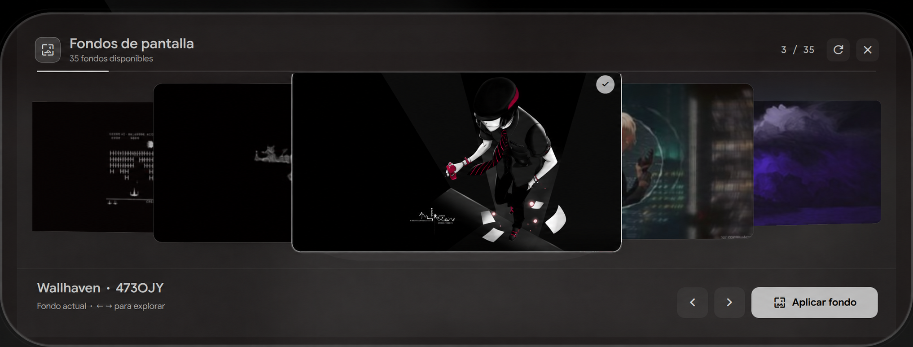

# egaldidots

My CachyOS / Arch dotfiles, built around Hyprland and Isla, a Quickshell desktop
bar. Wallpaper colors carry through the shell, terminal, editor and GTK theme.



## Desktop

- Isla: launcher, workspaces, media, calendar, notifications and clipboard.
- Edots: settings for the bar layout, appearance and optional modules.
- A Quickshell lockscreen, with hyprlock as a fallback.
- Fish and Starship, Kitty, LazyVim, fastfetch and Matugen.
- Isla provides the launcher, notifications and session menu; Matugen generates colors.

The screenshots show an earlier version of Isla.

## Install

Requires an installed Arch-based system, working GPU drivers, Git, internet
access and a normal user with sudo access.

```sh
git clone https://github.com/Edgardy715/egaldidots.git ~/egaldidots
cd ~/egaldidots
./install.sh
```

The installer upgrades system packages, installs official and AUR dependencies,
backs up conflicting configuration, and links the dotfiles with GNU Stow. It
also builds the wallpaper plugin, sets up Fish and Neovim plugins, generates
the initial palette, enables network and audio services, and selects Fish as
the login shell. Use `--keep-shell` to keep your current shell.

When cargo is available, installation also builds the optional Rust CAVA helper
and in-process audio peak library. The shell keeps its QML/Qt interface and
Python fallbacks. Build them separately with `sh scripts/build-cava-helper.sh`
and `sh scripts/build-audio-peak.sh`; Rust is not required at runtime. See
[CAVA measurements](docs/rust-cava-2026-10-21/REPORT.md) and
[peak measurements](docs/rust-audio-peak-2026-10-21/REPORT.md).

Saved clipboard lists also have an optional Rust reader, built with
`sh scripts/build-clipboard-list.sh`. Python retains all clipboard writes and
serves as fallback. See [clipboard measurements](docs/rust-clipboard-list-2026-10-21/REPORT.md).

Backups live in `~/.egaldidots-backup-*`. Keep the checkout in place: the installed
configuration links to it. The installer does not install the OS, GPU drivers
or a display manager, or restore personal files and credentials.

Log into Hyprland, then run:

```sh
./install.sh --check
```

Useful options:

| Option | Purpose |
| --- | --- |
| `--stow-only` | Restore configuration with dependencies already installed |
| `--deps-only` | Install dependencies |
| `--wallpaper FILE` | Set the initial wallpaper |
| `--hardware-profile original` | Use my original NVIDIA laptop and 240 Hz dock setup |
| `--keep-shell` | Keep the current login shell |

The default hardware profile uses the preferred mode of connected monitors.
Put your own monitor and GPU overrides in `~/.config/hypr/local.hardware.conf`.
See [recovery](docs/RECOVERY.md) for backup behavior and troubleshooting.

## Use

| Shortcut | Action |
| --- | --- |
| Super + S | Launcher |
| Super + I | Settings |
| Super + W | Wallpapers |
| Super + N | Notifications |
| Super + V | Clipboard |
| Super + M | Session menu |
| Super + L | Lock |
| Super + R | Reload Isla |

Settings are stored in `~/.config/isla/shell.json`. Open Edots with Super + I,
or use `bar/shell.json.example` as a starting point for manual edits.
See [Edots](docs/EDOTS.md) for save, discard and file selection.

To run Isla directly from the checkout:

```sh
quickshell -p bar
```

Change wallpaper through Isla or run:

```sh
bash ~/.config/hypr/scripts/apply-wallpaper.sh /path/to/image.png
```

## Development

### Recording from Isla

Open the eyes beside the clock, then **Grabación**, or use
`quickshell -p bar ipc call island recording ''`. Install `gpu-screen-recorder`
and a working Wayland ScreenCast portal. Python 3 is the only bridge dependency;
OBS and Python websockets are no longer used.

Start has a cancellable 3-second countdown, followed by the native screen/window
picker. System audio and microphone are independent; microphone defaults off.
The recorder uses hardware H.264, up to 30 fps and variable frame rate, with no
CPU encoding fallback. Files are saved to `~/Videos/Recordings`. A separate droplet to the left of the pill shows elapsed time, pause and
finalization. Clicking it opens recording controls. When space is insufficient
or another left surface needs the area, status returns to the main pill. The file is
only offered after the recorder exits successfully with a nonempty file.

Leaving the controls during countdown cancels it. An active capture keeps running
when the panel closes; exiting/reloading Isla finalizes its owned capture.
It never signals unrelated recorder processes. With the controls closed and no capture, the bridge exits: no idle subprocess,
status polling or OBS connection. `quickshell -p bar ipc call recording status` reports state.

- [Shell architecture and settings API](docs/SHELL_ARCHITECTURE.md)
- [Authentication and lockscreen setup](docs/AUTHENTICATION.md)
- [Tests](bar/TESTING.md)
- [Fluid Island](bar/fluid/README.md)

The shell requires Qt 6.10 or newer. The installer builds Wpscan against the
installed Qt version.

## Credits

[Quickshell](https://quickshell.org), [Hyprland](https://hyprland.org),
[Matugen](https://github.com/InioX/matugen),
[Starship](https://starship.rs) and [LazyVim](https://www.lazyvim.org).
Fluid Island references are listed in its [README](bar/fluid/README.md).

[MIT](LICENSE) · Edgardy715
